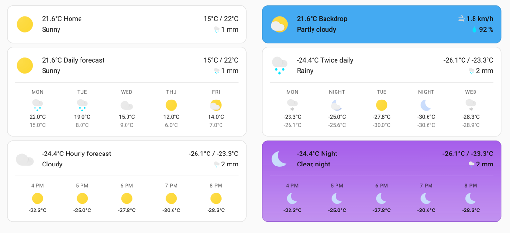
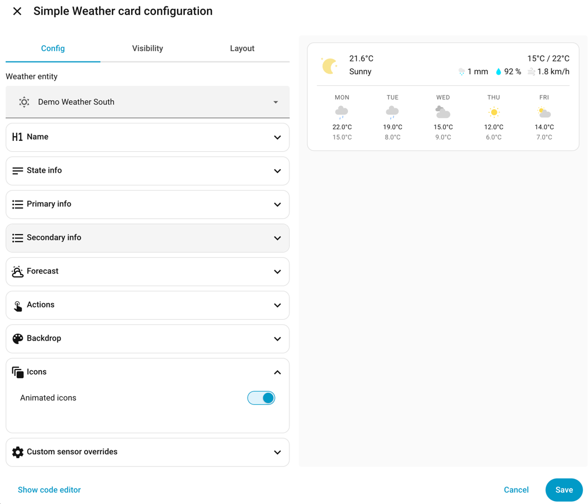

# Simple Weather Card

[](https://github.com/I-Simen-I/simple-weather-card/releases/latest)
[](https://github.com/I-Simen-I/simple-weather-card/commits/master)
[](#marketplace-recommended)

A clean, minimal weather card for [Home Assistant](https://www.home-assistant.io/) dashboards, with a forecast, day and night icons and a visual editor.



> A fork of [simple-weather-card](https://github.com/kalkih/simple-weather-card) by [@kalkih](https://github.com/kalkih), kept up to date with current Home Assistant releases.

## Features

- **Current weather** at a glance: temperature, condition and the details you choose, like low/high, precipitation, wind, humidity and pressure
- **Forecast**: daily, hourly or twice daily (day and night), with as many days or hours as you like
- **Day and night**: icons and the optional backdrop color follow the sun
- **Animated icons** as an option
- **Actions** on tap, hold and double tap, with every action Home Assistant supports
- **Visual editor** in your Home Assistant language
- **Custom sensors**: replace any value with one of your own sensors
- **Sections and masonry dashboards**, keyboard support and styling with card-mod

## Installation

Requires Home Assistant 2026.4 or newer.

### Marketplace (recommended)

From Home Assistant 2026.11, HACS is built in as the **Marketplace** (Settings → Marketplace). On older versions, use [HACS](https://hacs.xyz/); the steps are the same.

[](https://my.home-assistant.io/redirect/hacs_repository/?owner=I-Simen-I&repository=simple-weather-card&category=plugin)

1. Click the button above, or add `https://github.com/I-Simen-I/simple-weather-card` as a custom repository of type **Dashboard**. In the Marketplace, adding custom repositories needs a connection to GitHub.
2. Download **Simple Weather Card**.
3. Reload your browser.

### Manual

1. Download `simple-weather-card.js` from the [latest release](https://github.com/I-Simen-I/simple-weather-card/releases/latest) and copy it to your `config/www` folder. If the folder doesn't exist, create it and restart Home Assistant, which only serves `/local/` from a folder that existed when it started.
2. Go to **Settings → Dashboards → ⋮ → Resources** and add `/local/simple-weather-card.js` as a **JavaScript module**.
3. Reload your browser.

### Migrating from the original card

1. Remove the original Simple Weather Card in the Marketplace (or HACS), or its file and resource if you installed it manually.
2. Install this card as described above.
3. Existing card configs keep working, with one exception: `backdrop: true` must be written as:

   ```yaml
   backdrop:
     bg: true
   ```

## Configuration

### Visual editor

Add the card from the card picker and configure it in the editor. Every option below is available there.



### YAML

```yaml
type: custom:simple-weather-card
entity: weather.home
```

#### Card options

**General**

| Name             | Type    | Default         | Since  | Description                                                                        |
| ---------------- | ------- | --------------- | ------ | ---------------------------------------------------------------------------------- |
| `type`           | string  | **required**    | v0.1.0 | `custom:simple-weather-card`                                                       |
| `entity`         | string  | **required**    | v0.1.0 | A `weather` entity                                                                 |
| `name`           | string  | entity name     | v0.1.0 | Custom name                                                                        |
| `show_name`      | boolean | `true`          | v2.0.1 | Show the name                                                                      |
| `state_content`  | string  | `state`         | v2.8.0 | What to show below the name: `state` or a [weather attribute](#weather-attributes) |
| `primary_info`   | list    | `extrema`       | v0.7.0 | First row on the right, one or more [weather attributes](#weather-attributes)      |
| `secondary_info` | list    | `precipitation` | v0.2.0 | Second row on the right, one or more [weather attributes](#weather-attributes)     |
| `custom`         | list    |                 | v0.4.0 | Replace values with your own sensors, see [Custom sensors](#custom-sensors)        |

**Forecast**

| Name             | Type    | Default | Since   | Description                                                 |
| ---------------- | ------- | ------- | ------- | ----------------------------------------------------------- |
| `show_forecast`  | boolean | `false` | v2.5.0  | Show the forecast                                           |
| `forecast_type`  | string  | `daily` | v2.6.2  | `daily`, `hourly` or `twice_daily` (day and night, v2.12.0) |
| `forecast_slots` | number  | `5`     | v2.12.0 | Number of days, hours or day/night periods to show          |

**Appearance**

| Name             | Type    | Default | Since  | Description                                                               |
| ---------------- | ------- | ------- | ------ | ------------------------------------------------------------------------- |
| `animated_icons` | boolean | `false` | v2.8.0 | Animated weather icons                                                    |
| `backdrop`       | object  |         | v2.0.0 | Colored background, see [Backdrop](#backdrop)                             |
| `card_mod`       | object  |         | v2.1.1 | Styling with [card-mod](https://github.com/thomasloven/lovelace-card-mod) |
| `uix`            | object  |         | v2.3.0 | Styling with UIX                                                          |

**Actions**

| Name                | Type   | Default     | Since   | Description                            |
| ------------------- | ------ | ----------- | ------- | -------------------------------------- |
| `tap_action`        | object | `more-info` | v0.5.0  | Action on tap, see [Actions](#actions) |
| `hold_action`       | object |             | v2.12.0 | Action on hold (long press)            |
| `double_tap_action` | object |             | v2.12.0 | Action on double tap                   |

#### Weather attributes

Values for `state_content`, `primary_info` and `secondary_info`.

| Name                            | Description                                    | Since  |
| ------------------------------- | ---------------------------------------------- | ------ |
| `extrema`                       | Low and high temperature from the forecast     | v0.7.0 |
| `precipitation`                 | Precipitation from the forecast                | v0.7.0 |
| `precipitation_probability`     | Probability of precipitation from the forecast | v0.7.0 |
| `precipitation_and_probability` | Precipitation and probability together         | v2.7.0 |
| `humidity`                      | Current humidity                               | v0.7.0 |
| `pressure`                      | Current air pressure                           | v0.7.0 |
| `wind_speed`                    | Current wind speed                             | v0.7.0 |
| `wind_bearing`                  | Current wind direction                         | v0.7.0 |
| `wind`                          | Wind speed and direction together              | v2.7.0 |
| `apparent_temperature`          | Current "feels like" temperature               | v2.9.0 |

Forecast values come from the first day (or hour, with `forecast_type: hourly`). Attributes your weather integration doesn't provide are hidden.

#### Custom sensors

Replace values from the weather entity with your own sensors, for example a temperature sensor outside your window:

```yaml
custom:
  - temp: sensor.outdoor_temperature
  - humidity: sensor.outdoor_humidity
```

Possible keys: `temp`, `apparent_temperature`, `high`, `low`, `state`, `icon-state`, `precipitation`, `precipitation_probability`, `humidity`, `pressure`, `wind_speed` and `wind_bearing`.

- `state` replaces the condition text, and `icon-state` the condition used for the icon
- A `wind_bearing` sensor reporting degrees is shown as a direction, like `SW`

#### Backdrop

| Name    | Type    | Default                  | Description                 |
| ------- | ------- | ------------------------ | --------------------------- |
| `bg`    | boolean | `false`                  | Colored background          |
| `fade`  | boolean | `false`                  | Fade the background out     |
| `day`   | string  | `#45aaf2`                | Background color in the day |
| `night` | string  | `#a55eea`                | Background color at night   |
| `text`  | string  | `var(--text-dark-color)` | Text color                  |

Colors can be any CSS color, including theme variables like `var(--primary-color)`.

#### Actions

Actions are handled by Home Assistant itself, so every [dashboard action](https://www.home-assistant.io/dashboards/actions/) works, including `confirmation`. The most common options:

| Name              | Description                                                                    |
| ----------------- | ------------------------------------------------------------------------------ |
| `action`          | `more-info`, `toggle`, `navigate`, `url`, `perform-action`, `assist` or `none` |
| `entity`          | Entity for `more-info`, if not the card's weather entity                       |
| `navigation_path` | Path for `navigate`, like `/lovelace/weather`                                  |
| `url_path`        | URL for `url`                                                                  |
| `perform_action`  | Action for `perform-action`, like `light.toggle`                               |
| `data`, `target`  | Data and target for `perform-action`                                           |

The legacy `call-service` action with `service` and `service_data` still works.

## Examples

### Forecast

```yaml
type: custom:simple-weather-card
entity: weather.home
show_forecast: true
forecast_type: hourly
forecast_slots: 7
```

### Backdrop

The color follows the sun.

```yaml
type: custom:simple-weather-card
entity: weather.home
backdrop:
  bg: true
```

With your own colors:

```yaml
type: custom:simple-weather-card
entity: weather.home
backdrop:
  bg: true
  day: var(--primary-color)
  night: "#40445a"
```

### Choosing what to show

```yaml
type: custom:simple-weather-card
entity: weather.home
state_content: apparent_temperature
primary_info:
  - wind
  - humidity
secondary_info:
  - precipitation_and_probability
```

### Actions

```yaml
type: custom:simple-weather-card
entity: weather.home
tap_action:
  action: more-info
hold_action:
  action: navigate
  navigation_path: /lovelace/weather
double_tap_action:
  action: perform-action
  perform_action: homeassistant.update_entity
  target:
    entity_id: weather.home
```

## Translations

The visual editor follows your Home Assistant language. It's available in Czech, Danish, English, Finnish, German, Hungarian, Icelandic, Lithuanian, Norwegian (bokmål, also used for nynorsk), Polish, Slovak, Swedish and Ukrainian. Weather conditions, wind directions and "Night" use Home Assistant's own translations.

To add a language, copy [`src/translations/en.json`](src/translations/en.json) to `<language>.json`, translate the values, add it to `LANGUAGES` in [`src/localize.ts`](src/localize.ts) and open a pull request. Missing keys fall back to English.

## Troubleshooting

- **"Custom element doesn't exist: simple-weather-card"**: the card isn't loaded. Check that it's installed in the Marketplace (or HACS), or added as a resource if you installed it manually, then reload your browser.
- **Changes don't show after an update**: your browser is using a cached copy. Reload without cache (Ctrl+Shift+R or Cmd+Shift+R), or clear the cache in the Home Assistant app.
- **No forecast**: check that `show_forecast: true` is set, and that your weather integration supports the chosen `forecast_type`. Not all integrations provide hourly or twice daily forecasts.

Still stuck? [Open an issue](https://github.com/I-Simen-I/simple-weather-card/issues).

## Development

Requires Node 24 or newer and Yarn 4 via Corepack. Node 25 and newer no longer include Corepack, so install it separately (for example `brew install corepack` or `npm install -g corepack`) and run `corepack enable`.

```bash
yarn install     # install dependencies
yarn build       # build dist/simple-weather-card.js
yarn watch       # rebuild on changes
yarn typecheck   # TypeScript
yarn lint        # ESLint and Prettier
yarn test        # smoke tests of the built card
yarn ha:up       # local Home Assistant with demo data on http://localhost:8123 (needs Docker and a build)
```

The local test environment, the screenshots and the release process are described in [`dev/README.md`](dev/README.md).

Built with TypeScript, Lit 3 and webpack.

## License

[MIT](LICENSE)
