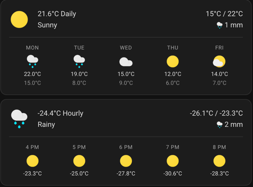

# Simple Weather Card

[](https://github.com/I-Simen-I/simple-weather-card/releases/latest)[](https://github.com/I-Simen-I/simple-weather-card/commits/master)[](https://github.com/hacs/integration)

> A fork of [simple-weather-card](https://github.com/kalkih/simple-weather-card) by [@kalkih](https://github.com/kalkih), kept up to date with current Home Assistant releases.

A clean, highly configurable weather card for the [Home Assistant](https://github.com/home-assistant/home-assistant) Lovelace UI, inspired by Google Material Design. Kept up to date with the latest Home Assistant standards, easy to install via HACS, and comes with a built-in UI editor so you can configure the card without writing YAML.


### Forecast




## Migration from Original Repository

If you're migrating from the [original repository](https://github.com/kalkih/simple-weather-card) or any of the older forks:

### Switching to This Fork

**Via HACS:**

1. Remove the old integration from HACS.
2. Add this repository as a custom repository: `https://github.com/I-Simen-I/simple-weather-card`

[](https://my.home-assistant.io/redirect/hacs_repository/?owner=I-Simen-I&repository=simple-weather-card&category=plugin)

3. Install from HACS.
4. Clear your browser cache after updating.

**Manual:**

1. Download `simple-weather-card.js` from the [latest release](https://github.com/I-Simen-I/simple-weather-card/releases/latest).
2. Replace the existing file in your `www` folder.
3. Clear your browser cache.

## Using the card

### New UI Editor


### YAML Editor

#### Card options

| Name           | Type                                        | Default         | Since  | Description                                                                                  |
|----------------|---------------------------------------------|-----------------|--------|----------------------------------------------------------------------------------------------|
| type           | string                                      | **required**    | v0.1.0 | `custom:simple-weather-card`                                                                 |
| entity         | string                                      | **required**    | v0.1.0 | The entity_id from an entity within the `weather` domain.                                    |
| name           | string                                      | optional        | v0.1.0 | Set a custom name.                                                                           |
| state_content  | string                                      | `state`         | v2.8.1 | State card information.                                                                      |
| animated_icons | boolean                                     | false           | v2.8.1 | Enable/Disable animated icons.                                                               |
| primary_info   | array/string                                | `extrema`       | v0.7.0 | Primary card information, one or more [weather attributes](#weather-attributes)              |
| secondary_info | array/string                                | `precipitation` | v0.2.0 | Secondary card information, one or more [weather attributes](#weather-attributes)            |
| backdrop       | [Backdrop object](#backdrop-object-options) | optional        | v2.0.0 | [Backdrop object](#backdrop-object-options).                                                 |
| custom         | array                                       | optional        | v0.4.0 | Override weather information with custom sensors, see [Custom option](#custom-option-array). |
| tap_action     | [action object](#action-object-options)     | optional        | v0.5.0 | Action on click/tap.                                                                         |
| show_name      | boolean                                     | true            | v2.1.0 | Show/Hide name                                                                               |
| show_forecast  | boolean                                     | false           | v2.5.0 | Show/Hide 5 day forecast                                                                     |
| forecast_type  | string                                      | `daily`         | v2.6.0 | Show daily or hourly forecast                                                                |

#### Weather attributes

| Name                          | Description                                           | Since  |
|-------------------------------|-------------------------------------------------------|--------|
| extrema                       | Forecast high and low temperature                     | v0.7.0 |
| precipitation_and_probability | Forecast precipitation + Probability of precipitation | v2.7.0 |
| precipitation                 | Forecast precipitation                                | v0.7.0 |
| precipitation_probability     | Probability of precipitation                          | v0.7.0 |
| humidity                      | Current humidity                                      | v0.7.0 |
| wind                          | Current wind speed + direction                        | v2.7.0 |
| wind_speed                    | Current wind speed                                    | v0.7.0 |
| wind_bearing                  | Current wind direction                                | v0.7.0 |
| pressure                      | Current air pressure                                  | v0.7.0 |
| apparent_temperature          | Current apparent (feels like) temperature             | v2.9.0 |

#### Backdrop object options

See [Backdrop example](#backdrop-example) for example usage.

| Name  | Type    | Default                  | Description               |
|-------|---------|--------------------------|---------------------------|
| bg    | boolean | `false`                  | Colored background.       |
| fade  | boolean | `false`                  | Faded background.         |
| day   | string  | '#45aaf2'                | Background color (Day).   |
| night | string  | '#a55eea'                | Background color (Night). |
| text  | string  | 'var(--text-dark-color)' | Text color.               |

#### Custom option array

See [Custom example](#custom-sensors-example) for example usage.
Possible entries are: `temp`, `apparent_temperature`, `high`, `low`, `state`, `precipitation`, `humidity`, `icon-state`, `wind_speed`, `wind_bearing`, `pressure` & `precipitation_probability`.

```yaml
custom:
  - temp: sensor.home_temp
  - high: sensor.home_high_temp
  - low: sensor.home_low_temp
```

#### Action object options

Actions are handled by Home Assistant, so all [standard actions](https://www.home-assistant.io/dashboards/actions/) are supported.

| Name            | Type   | Default     | Options                                                                          | Description                                                                                |
|-----------------|--------|-------------|----------------------------------------------------------------------------------|--------------------------------------------------------------------------------------------|
| action          | string | `more-info` | `more-info`, `toggle`, `navigate`, `url`, `perform-action`, `assist`, `none`     | Action to perform                                                                          |
| perform_action  | string | none        | Any action                                                                       | Action to call (e.g. `media_player.toggle`) when `action` is defined as `perform-action`   |
| data            | object | none        | Any action data                                                                  | Data to include with the action call                                                       |
| target          | object | none        | Any target                                                                       | Target of the action call (e.g. `entity_id: media_player.office`)                          |
| navigation_path | string | none        | Any path                                                                         | Path to navigate to (e.g. `/lovelace/0/`) when `action` is defined as `navigate`           |
| url_path        | string | none        | Any URL                                                                          | URL to open when `action` is defined as `url`                                              |
| entity          | string | none        | Any entity id                                                                    | Override default entity of more-info, when `action` is defined as `more-info`              |

The legacy `call-service` action with `service` and `service_data` is still supported.

### Example usage

#### Standard card


```yaml
- type: custom:simple-weather-card
  entity: weather.smhi
  name: in current location
```

#### Backdrop example


```yaml
- type: custom:simple-weather-card
  entity: weather.smhi
  name: " "
  backdrop: true
```

#### Custom backdrop example


```yaml
- type: custom:simple-weather-card
  entity: weather.smhi
  name: at home
  backdrop:
    day: "var(--primary-color)"
    night: "#40445a"
```

#### Customize weather information example


```yaml
- type: custom:simple-weather-card
  entity: weather.smhi
  primary_info:
    - wind_bearing
    - humidity
  secondary_info:
    - precipitation
    - precipitation_probability
```

#### Custom sensors example

```yaml
- type: custom:simple-weather-card
  entity: weather.smhi
  custom:
    - temp: sensor.home_temp
    - high: sensor.home_high_temp
    - low: sensor.home_low_temp
```

## Problems?

Make sure you have the latest version of `simple-weather-card.js`.

If you have issues after updating the card, try clearing the browser cache manually.

If you are getting "Custom element doesn't exist: simple-weather-card", try clearing the browser cache or restarting Home Assistant.

## Development

**Requirements:** Node 24, Yarn 4.12

```bash
yarn install       # install dependencies
yarn build         # build → dist/simple-weather-card.js
yarn watch         # watch mode with source maps
yarn typecheck     # TypeScript type checking
yarn lint          # ESLint
```

**Tech stack:** TypeScript, webpack 5, ts-loader, Lit 3, ESLint with prettier

Releases are created automatically by GitHub Actions when a `v*.*.*` tag is pushed. The workflow builds the bundle, updates the version, and publishes `dist/simple-weather-card.js` as a release asset for HACS.

## License

This project is under the MIT license.
